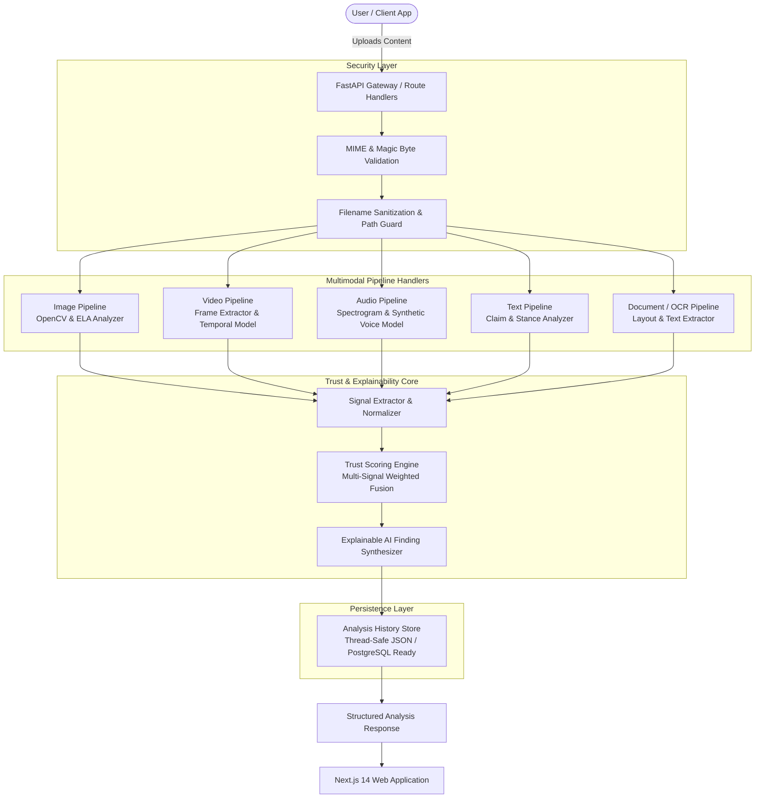

# TrustNet AI — System Architecture & Design

TrustNet AI is a multimodal digital content authenticity and trust scoring platform. It analyzes digital artifacts (images, videos, audio recordings, text claims, screenshots, and documents) to determine whether content is authentic, synthetic (AI-generated), or manipulated, delivering an explainable 0–100 Trust Score.

---

## 1. High-Level Architecture Overview

---

## 2. Multimodal Pipelines Breakdown

### A. Image Authenticity & Manipulation Analysis (Stage 1 Active)
1. **Validation**: Enforces JPEG, PNG, WEBP, and TIFF extensions, checking file signatures (magic numbers) and max file sizes (15 MB default).
2. **Feature Extraction**:
   - **Error Level Analysis (ELA)**: Re-compresses image at a known quality level to detect differences in compression artifact rates across image regions.
   - **Noise Variance & Frequency**: Evaluates high-frequency DCT/Laplacian components to identify synthetic smoothing or inconsistent noise floors.
   - **Sharpness / Blur Variance**: Computes Laplacian variance across grid quadrants.
   - **Metadata & EXIF Extraction**: Checks for camera provenance, software modification markers (e.g. Photoshop, Stable Diffusion tags), and timestamp integrity.
3. **Model Abstraction (`ImageAuthenticityModel`)**:
   - Outputs a probability distribution: `authentic_probability`, `ai_generated_probability`, `manipulated_probability`.
   - In Stage 1, uses calibrated heuristic analysis + marked `DEMO / MOCK INFERENCE` interface ready for drop-in PyTorch / ONNX models (EfficientNet-B4 / Xception / ConvNeXt / CLIP).

### B. Video Intelligence Pipeline (Stage 3 Ready)
- Frame extraction with keyframe sampling (adaptive FPS).
- Face & object bounding box tracking across frames.
- Frame-by-frame authenticity scoring and temporal continuity evaluation (detecting flicker, warp, and mouth-sync inconsistency).
- Suspicious frame timeline generation.

### C. Audio Intelligence Pipeline (Stage 4 Ready)
- Mel spectrogram and MFCC feature transformation.
- Synthetic speech artifact detection (phase discontinuity, vocal tract biological constraints).
- Voice cloning probability estimation.

### D. Text & News Claim Analysis (Stage 5 Ready)
- Named Entity Recognition (NER) & core claim extraction.
- Cross-source agreement analysis.
- Uncertainty-aware claim verification labels: *Supported*, *Partially Supported*, *Insufficient Evidence*, *Contradicted*, *Unable to Verify*.

### E. Document & OCR Intelligence (Stage 6 Ready)
- OCR text layer extraction.
- Digital document layout tampering and font inconsistency checks.

---

## 3. Explainability & Uncertainty Communication

TrustNet AI strictly adheres to probabilistic scientific communication:
- Results are presented as probabilistic estimations rather than binary truth claims.
- The UI features a prominent scientific limitation disclaimer:
  > *"This result represents a model-based assessment and should not be treated as absolute proof of authenticity or deception."*
- Every analysis produces granular findings derived from real computed signals.
